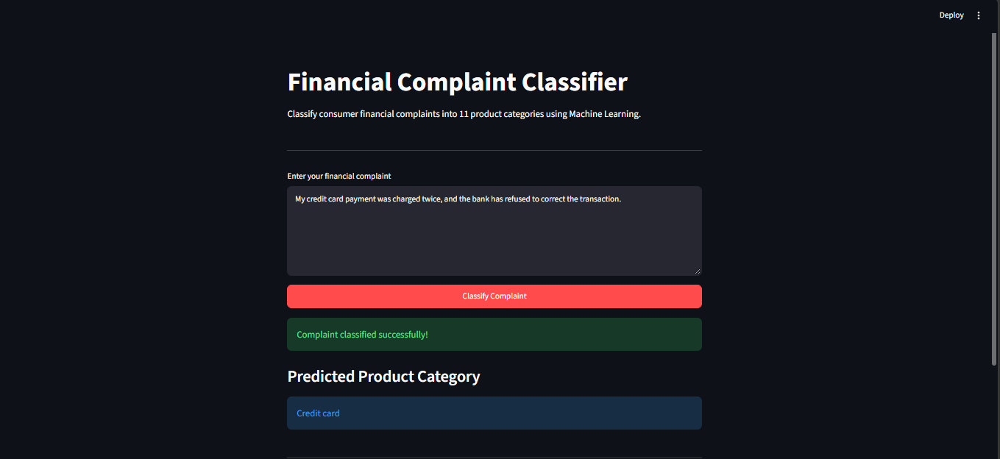

# Financial Complaint Classifier

An NLP-based machine learning project that automatically classifies consumer financial complaints into 11 product categories using TF-IDF and Logistic Regression.

## Project Overview

This project uses TF-IDF feature extraction and Logistic Regression to classify complaint narratives from the Consumer Financial Protection Bureau (CFPB) Consumer Complaint Database.

The goal is to build a reproducible text-classification pipeline, evaluate its performance, and provide reusable training and prediction modules.

The project also includes an interactive Streamlit application for testing the trained classifier.

## Dataset

Source: [CFPB Consumer Complaint Database](https://www.consumerfinance.gov/data-research/consumer-complaints/)

- Original records: 614,945
- Cleaned records: 19,163
- Target column: `Product`
- Input column: `Consumer complaint narrative`
- Number of classes: 11

### Data Cleaning

The cleaning pipeline:

1. Removes missing complaint narratives.
2. Removes narratives that become empty after normalization.
3. Removes narratives associated with conflicting product labels.
4. Removes exact duplicate narratives.
5. Removes groups with conflicting labels after normalization.
6. Removes normalized duplicate narratives.

Normalization is used for duplicate detection only. It lowercases text, removes standalone `XXXX` placeholders, and normalizes whitespace.

The original complaint narrative is preserved for model training.

Raw and processed datasets are excluded from version control.

## Model Architecture

The classification pipeline is:

```text
Complaint Narrative
        |
        v
TF-IDF Vectorizer
        |
        v
Logistic Regression
        |
        v
Predicted Product Category
```

### Selected Hyperparameters

| Parameter | Value |
|---|---|
| TF-IDF min_df | 2 |
| TF-IDF ngram_range | (1, 2) |
| Logistic Regression C | 2.0 |
| Logistic Regression max_iter | 1000 |
| Logistic Regression class_weight | balanced |
| Random seed for splitting | 42 |

Hyperparameters were selected using validation experiments and stratified cross-validation.

## Final Model Performance

The final model was trained on 15,330 complaints and evaluated on 3,833 held-out test complaints.

| Metric | Score |
|---|---:|
| Test accuracy | 81.55% |
| Macro F1-score | 73.80% |

Performance varies across the 11 product categories. Some minority classes have substantially lower recall than the more common categories.

### Reproducing the Final Evaluation

After preparing the cleaned CFPB dataset, run:

```powershell
python -m src.evaluate
```

The evaluation script:

1. Creates a reproducible stratified 80/20 train-test split.
2. Trains the selected TF-IDF and Logistic Regression pipeline on the 80% training portion.
3. Evaluates the model on the held-out 20%.
4. Saves aggregated evaluation results to `reports/test_metrics.json`.

The report includes:

- Test accuracy
- Macro F1-score
- Per-class precision, recall, F1-score, and support
- Confusion matrix and class labels

The selected hyperparameters were determined before final test evaluation.

The results were reproduced locally using the same cleaned dataset and configuration.

The report contains aggregated metrics only, not original complaint narratives.

### Near-Duplicate Diagnostic Analysis

We investigated potential textual overlap between training and test complaints using TF-IDF cosine similarity.

Run the diagnostic:

```powershell
python -m src.near_duplicate_analysis
```

The analysis uses the original stratified split. It does not alter the cleaned dataset, test set, or selected model parameters.

#### Findings

| Metric | Result |
|---|---:|
| Training samples | 15,330 |
| Test samples | 3,833 |
| Mean maximum similarity | 0.3515 |
| Median maximum similarity | 0.2700 |
| Test samples with similarity >= 0.80 | 421 |
| Test samples with similarity >= 0.90 | 340 |
| Test samples with similarity >= 0.95 | 263 (6.86%) |
| Test samples with similarity >= 0.99 | 85 |
| High-similarity group accuracy (>= 0.95) | 96.20% |
| Lower-similarity group accuracy (< 0.95) | 80.48% |

Of the 263 high-similarity complaints, 231 belong to the Debt collection category.

Within Debt collection, recall was:

- 96.10% for the high-similarity group.
- 83.97% for the lower-similarity group.

These findings suggest that highly similar complaints may contribute to optimistic performance estimates.

However, high textual similarity alone does not establish data leakage. Differences in class distributions and complaint characteristics may partially explain the observed gap.

The reported 81.55% accuracy remains the result of the original random stratified split. It should not be interpreted as guaranteed performance on independent future complaints.

Aggregated diagnostic results are available in `reports/near_duplicate_analysis.json`.

### Group-Aware Robustness Evaluation

An additional robustness experiment evaluates the selected TF-IDF and Logistic Regression model using a group-disjoint train/test split.

The purpose is to investigate whether highly similar complaints appearing in both training and testing affect the reported model performance.

#### Methodology

The evaluation follows these steps:

1. Load all 19,163 cleaned complaint narratives.
2. Transform the narratives using TF-IDF with unigram and bigram features.
3. Calculate cosine similarity using batched sparse computations.
4. Connect complaint pairs with cosine similarity >= 0.95.
5. Use connected components to create text-based groups.
6. Apply GroupShuffleSplit with a fixed random seed of 42.
7. Ensure that no text group appears in both training and testing.
8. Train the selected TF-IDF and Logistic Regression pipeline.
9. Evaluate accuracy and macro F1-score.
10. Save aggregated results to a JSON report.

The grouping procedure is unsupervised but uses text from the entire dataset. Therefore, this experiment is a robustness diagnostic rather than a fully independent evaluation.

#### Grouping Statistics

| Metric | Result |
|---|---:|
| Total complaints | 19,163 |
| Total text groups | 18,212 |
| Groups with multiple complaints | 306 |
| Complaints in multi-member groups | 1,257 |
| Largest group | 408 |
| Similarity threshold | 0.95 |

Connected components can form relatively large groups because of transitive similarity links.

For example, if complaint A is highly similar to B, and B is highly similar to C, all three may belong to the same group even if A and C are less similar to each other.

This behavior is relevant to the objective of preventing high-similarity links from crossing the train/test boundary.

#### Evaluation Results

| Metric | Original Evaluation | Group-Aware Evaluation |
|---|---:|---:|
| Accuracy | 81.55% | 82.16% |
| Macro F1-score | 73.80% | 72.14% |
| Training samples | 15,330 | 15,021 |
| Test samples | 3,833 | 4,142 |

Additional group-aware split statistics:

| Metric | Result |
|---|---:|
| Training groups | 14,569 |
| Testing groups | 3,643 |
| Group overlap | 0 |
| Classes in training | 11 |
| Classes in testing | 11 |

The group-aware evaluation produced slightly higher accuracy but lower macro F1-score than the original stratified evaluation.

These differences should not be interpreted as a direct measurement of the effect of removing near-duplicate overlap because the experiments use different test samples and class distributions.

In particular, GroupShuffleSplit does not guarantee class stratification.

#### Limitations

- The grouping process uses text from the full dataset.
- Connected components can create large groups through chains of similarity links.
- GroupShuffleSplit does not guarantee identical class proportions between training and testing.
- The experiment uses a single random group-aware split.
- Text-based groups do not necessarily represent independent customers or real-world complaint events.
- The similarity threshold of 0.95 is a diagnostic choice.
- Results are not guaranteed to represent performance on future complaints.

This experiment provides additional evidence about model robustness but does not replace the original held-out evaluation.

Aggregated results are available in `reports/group_aware_evaluation.json`.

To reproduce the experiment after preparing the cleaned dataset:

```powershell
python -c "from src.group_aware_evaluation import evaluate_group_aware; print(evaluate_group_aware())"
```

Note: Running `python -m src.group_aware_evaluation` currently executes a small grouping demonstration rather than the full evaluation.

## Limitations

- Performance varies across product categories.
- Minority classes, including Debt or credit management and Prepaid card, have relatively low recall.
- The dataset focuses on financial complaints rather than general customer support requests.
- The random stratified evaluation may not represent performance on future or independent complaint groups.
- Highly similar narratives can exist across the original training and test sets.
- Group-aware splitting is an additional diagnostic, not proof of future generalization.
- Model predictions should not replace human review in high-impact decisions.

## Project Structure

```text
financial-complaint-classifier/
|
|-- app.py                     # Streamlit application
|
|-- data/
|   |-- raw/                   # Local original dataset
|   `-- processed/             # Local cleaned dataset
|
|-- models/                    # Local trained models
|
|-- notebooks/
|   |-- 01_data_understanding.ipynb
|   |-- 02_text_preprocessing.ipynb
|   |-- 03_baseline_model.ipynb
|   `-- 04_model_experiments.ipynb
|
|-- src/
|   |-- data_processing.py
|   |-- train.py
|   |-- predict.py
|   |-- evaluate.py
|   |-- near_duplicate_analysis.py
|   `-- group_aware_evaluation.py
|
|-- tests/
|   |-- test_data_processing.py
|   |-- test_train.py
|   |-- test_predict.py
|   |-- test_evaluate.py
|   |-- test_near_duplicate_analysis.py
|   |-- test_group_aware_evaluation.py
|   `-- test_app.py
|
|-- reports/
|   |-- test_metrics.json
|   |-- near_duplicate_analysis.json
|   `-- group_aware_evaluation.json
|
|-- .github/
|   `-- workflows/
|       `-- tests.yml
|
|-- .gitignore
|-- requirements.txt
|-- requirements-dev.txt
`-- README.md
```

Raw datasets, processed datasets, and trained model artifacts are stored locally and are not committed to the repository.

## Installation

Python 3.14 was used during development.

### 1. Clone the repository

```powershell
git clone https://github.com/hazem-elsayed1/financial-complaint-classifier.git
cd financial-complaint-classifier
```

### 2. Create a virtual environment

```powershell
python -m venv .venv
```

### 3. Activate the virtual environment

Windows PowerShell:

```powershell
.\.venv\Scripts\Activate.ps1
```

macOS / Linux:

```bash
source .venv/bin/activate
```

### 4. Install dependencies

For running the classifier and Streamlit application:

```powershell
python -m pip install -r requirements.txt
```

For development, notebooks, and automated testing:

```powershell
python -m pip install -r requirements-dev.txt
```

The development requirements include all runtime dependencies.

## Dataset Preparation

This project uses the Consumer Financial Protection Bureau (CFPB) Consumer Complaint Database.

Download the dataset from:

https://www.consumerfinance.gov/data-research/consumer-complaints/

The original experiments used the export:

`CCDB_Export_16_March_2026.csv`

Place the CSV file inside:

`data/raw/`

The training and evaluation scripts expect the cleaned dataset at:

`data/processed/cleaned_complaints.csv`

To generate it, run the following command from the project root:

```powershell
python -m src.data_processing --input data/raw/CCDB_Export_16_March_2026.csv --output data/processed/cleaned_complaints.csv
```

The command reads the input CSV, applies the cleaning pipeline, and saves the processed dataset.

The original export used in this project contains 614,945 records and produces 19,163 cleaned complaints.

Different versions or filters of the CFPB dataset may produce different results.

Neither the raw dataset nor the cleaned dataset is included in this repository.

## Running Tests

Run the complete automated test suite:

```powershell
python -m pytest tests/ -q
```

The project currently includes 27 automated tests covering:

- Data cleaning and deduplication
- Empty normalized text handling
- Conflicting-label handling
- Data cleaning CLI
- Data splitting and reproducibility
- Final training split consistency
- Model prediction
- Model serialization and deserialization
- Evaluation report generation
- Near-duplicate similarity calculations
- Near-duplicate diagnostic report consistency
- Text grouping and connected components
- Grouping consistency across batches
- Group-aware train/test split isolation
- Group-aware evaluation report generation
- Streamlit interface title, input, and empty-complaint validation

## Training the Model

After preparing the cleaned CFPB dataset:

```python
from src.train import train_final_model, save_model

model = train_final_model(
    "data/processed/cleaned_complaints.csv"
)

save_model(
    model,
    "models/ticket_classifier.joblib"
)
```

The final model uses 80% of the cleaned dataset for training and reserves 20% for held-out testing.

The model file is saved locally and is excluded from version control.

## Making Predictions

```python
from src.predict import load_model, predict_complaint

model = load_model("models/ticket_classifier.joblib")

prediction = predict_complaint(
    model,
    "My credit card payment was charged twice."
)

print(prediction)
```

Only load model files from trusted sources. Loading untrusted joblib files can execute arbitrary code.

## Interactive Streamlit Demo

The project includes an interactive Streamlit application for classifying financial complaint narratives using the trained TF-IDF and Logistic Regression model.

### Features

- Enter a financial complaint in a text area.
- Classify the complaint using the trained model.
- Display the predicted financial product category.
- Validate empty inputs and show helpful messages.
- Cache the trained model to avoid repeated loading.

### Running the Application

First, install the runtime dependencies:

```powershell
python -m pip install -r requirements.txt
```

The trained model is not included in the repository because model artifacts are excluded from version control.

After preparing the cleaned dataset, generate the model locally:

```powershell
python -c "from src.train import train_final_model, save_model; model = train_final_model('data/processed/cleaned_complaints.csv'); save_model(model, 'models/ticket_classifier.joblib')"
```

Then start the application:

```powershell
python -m streamlit run app.py
```

Open `http://localhost:8501` in your browser.

### Example Complaint

"My credit card payment was charged twice, and the bank has refused to correct the transaction."

In the local demonstration, the trained model predicted:

**Credit card**

The application provides predictions for informational purposes and should not replace human review in high-impact financial decisions.

## Reproducibility

The project includes:

- Fixed random seed: 42
- Stratified train/validation/test splitting
- TF-IDF and Logistic Regression combined in a scikit-learn Pipeline
- Held-out test evaluation
- Reproducible evaluation and diagnostic scripts
- Group-aware robustness evaluation
- Aggregated JSON reports
- Automated tests using pytest
- Streamlit application tests
- Pinned direct dependencies in `requirements.txt` and `requirements-dev.txt`

The dataset snapshot and filtering criteria affect reproducibility.

The raw data is not distributed with the repository.

## Continuous Integration

The project uses GitHub Actions to run automated tests.

Workflow file:

`.github/workflows/tests.yml`

The workflow runs on pushes and pull requests, using Ubuntu and Python 3.14.

It installs the development dependencies from `requirements-dev.txt` and executes:

```powershell
python -m pytest tests/ -q
```

This helps detect regressions when the source code changes.

## Future Improvements

- Improve minority-class recall.
- Compare Logistic Regression against additional text classifiers.
- Add time-based evaluation.
- Evaluate performance across multiple group-aware splits.
- Investigate near-duplicate complaint groups more deeply.
- Add confidence intervals for evaluation metrics.
- Add a REST API for inference.
- Deploy the Streamlit demo.
- Add model monitoring.
- Improve packaging and dependency management.

## License

No license has been selected yet.
